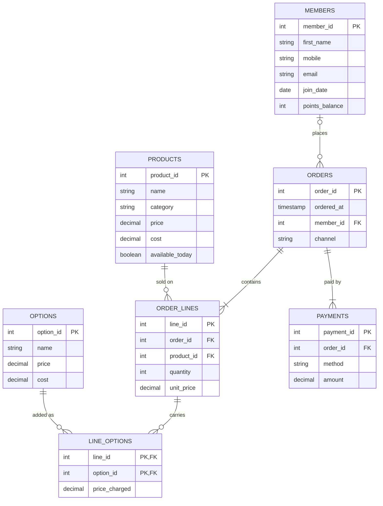

# Part A · The README
# Babson Bean Café Database

## 1. The Scenario

I will be working on Scenario C, the Babson Bean Cafe. Babson Bean is a cafe on campus. It records sales on its cash register and tracks loyalty members on paper punch cards, but neither lets the cafe look up answers to its questions. This database lets the cafe see what sells, which add ons earn their keep and who its regular customers are.

## 2. The ERD

## 3. What One Row Means
- One row of `members` is one person enrolled in Babson Bean's loyalty program.
- One row of `products` is one item on the café's menu, such as a latte or a muffin.
- One row of `options` is one add-on a drink can carry, such as oat milk or an extra shot.
- One row of `orders` is one purchase made at one time, at the counter or in the app, by one member or by a customer who is not a member.
- One row of `order_lines` is one product on one order, with how many were bought and the price charged that day.
- One row of `line_options` is one option added to one order line, with the price charged for it that day.
- One row of `payments` is one payment toward one order, by one method; an order can have several.

## 4. Design Choices
- I chose member_id as the primary key for the MEMBERS table instead of using a mobile number or email. A member's mobile number can change, and email is optional, so using a unique member ID is more reliable.

- Not every customer is a loyalty member, so an order does not always need a member_id. Members can also join without placing any orders. Similarly, an order line may have no add-ons, and a product may exist on the menu without being ordered.

- The database cannot use a simple CHECK constraint to ensure that an order's payments equal the total cost of its products and add-ons. I will use a SQL query to calculate both totals for each order, compare them, and identify any differences.

- I checked the relationship between ORDERS and PAYMENTS to make sure it matched the scenario. Each order must have at least one payment, but it can have multiple payments if a customer splits the bill between methods such as card and points. The ERD represents this as a one-to-many relationship.